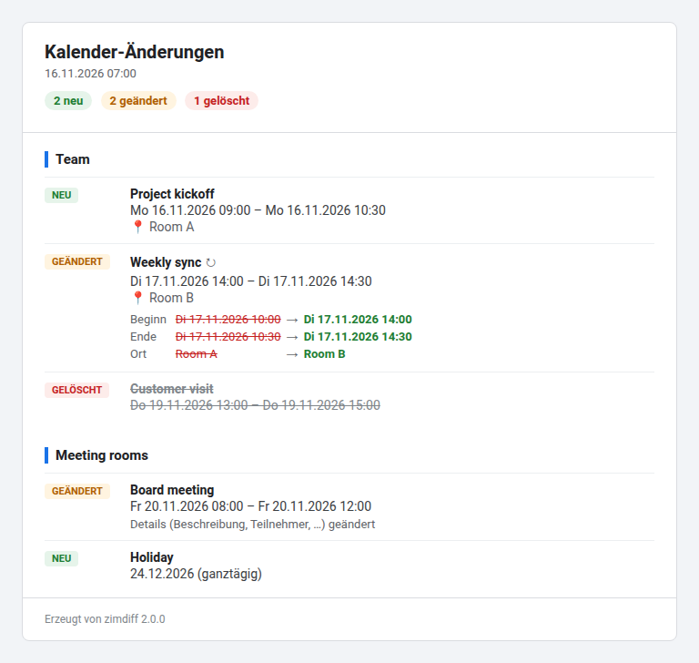

# zimdiff

Reports changes in Zimbra calendars by mail. Each run compares the
appointments of the configured calendars with the previous run and sends
an HTML mail listing new, changed and deleted appointments.



## Install

```sh
./bootstrap            # only in a fresh checkout
./configure --prefix=/opt/zimdiff
make
make install
```

`configure` needs perl 5.26 or newer, a C compiler and the OpenSSL headers.
`make` installs the Perl modules from `cpanfile` into `thirdparty/`.

## Setup

```sh
cd /opt/zimdiff
cp etc/zimdiff.conf.dist etc/zimdiff.conf
chmod 600 etc/zimdiff.conf
$EDITOR etc/zimdiff.conf
bin/zimdiff            # first run stores the current state
```

zimdiff reads the calendars through CalDAV, logged in as `zimbra.user`. The
calendars of other accounts must be shared with that account.

### Accounts with two factor authentication

An account with two factor authentication needs an application passcode;
its regular password with an OTP does not work for zimdiff.

1. In the Zimbra web client, open Preferences, Accounts.
2. Under Two-step authentication, next to Applications, choose
   Add Application Code.
3. Enter a name, for example `zimdiff`, and choose Next.
4. Copy the passcode; Zimbra shows it only once.
5. Put it in `etc/zimdiff.conf` as `zimbra.password`.

Zimbra accepts application passcodes for CalDAV, but not for its web client,
SOAP or REST interfaces. To revoke the passcode, remove it from the same list.

To run it daily at 07:00 from a systemd user timer:

```
/opt/zimdiff/bin/zimdiff --install-service
loginctl enable-linger    # also run while you are logged out
```

`--install-service=18:30` picks another time, `--uninstall-service`
removes the timer again.

`bin/zimdiff --man` documents the options and config keys.

The source tree runs without installing: after `make`, `bin/zimdiff` uses
`etc/` and `var/` of the tree.

## Credits

The initial code was written by Tobi Oetiker <tobi@oetiker.ch>.
